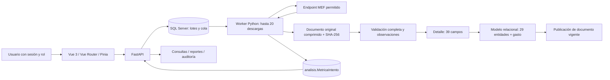
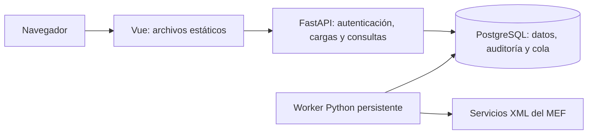

# Arquitectura de ProInXML

Documento de referencia: [especificación original](ESPECIFICACION.md), especialmente el contrato de base de datos de la sección 12. Esta descripción corresponde al código actual, con backend gestionado por uv y frontend Vue gestionado por pnpm.

## Arquitectura implementada

Python se ejecuta en `.venv`, sincronizado con `uv.lock`. Vue se desarrolla y compila con pnpm y `frontend/pnpm-lock.yaml`. FastAPI sirve `frontend/dist` en el mismo origen que la API; el despliegue local no necesita un servidor Node activo. La conexión a una instancia de SQL Server existente se configura mediante `.env`. API y worker son procesos independientes; la base conserva la cola.

Para trabajar en desarrollo, `iniciar.cmd` ejecuta `app.run --dev`: FastAPI en 8000, Vue/Vite en 5173 y el worker. El proxy de Vite incluye todas las rutas de la API, documentos, mantenimiento y documentación; el navegador conserva un mismo origen. Ctrl+C detiene los procesos iniciados y una salida inesperada de Vue o worker provoca el cierre del conjunto. `iniciar.cmd --compilado` conserva el modo de frontend compilado servido por FastAPI sin Node activo.

Las descargas se ejecutan en paralelo. La transacción que inserta el detalle y normaliza toma primero un bloqueo de aplicación; así evita conflictos entre las FK del detalle y otras normalizaciones. Publicar la versión vigente y completar el trabajo forman parte de esa misma transacción. Si el XML está truncado, se revierte el detalle; los bytes de la respuesta permanecen disponibles.

## Organización del código

| Archivo | Responsabilidad |
| --- | --- |
| `app/config.py` | Variables de entorno y límites de operación |
| `app/db.py` | Conexiones, transacciones y contexto de usuario para auditoría |
| `app/security.py` | Argon2, sesiones, CSRF, permisos y usuarios |
| `app/service.py` | Lotes, idempotencia, persistencia y reintentos manuales |
| `app/worker.py` | Descargas, concurrencia, pausas automáticas del servicio y fallos |
| `app/metrics.py` | Medición monotónica de fases y persistencia independiente del resultado de la carga |
| `app/analysis.py` | Resumen, P95, rendimiento, comparación e intentos medidos |
| `app/xml_reader.py` | Contrato de los 39 campos, tipos y observaciones |
| `app/normalizer.py` | Bloqueo previo y llamada al procedimiento de normalización |
| `app/explorer.py` | Datos, modelo, reportes, observaciones y auditoría paginados |
| `app/maintenance.py` | Vista previa y eliminación transaccional de datos del laboratorio |
| `app/locks.py` | Bloqueo compartido/exclusivo entre mantenimiento, API y worker |
| `app/main.py` | API de carga y seguimiento |
| `app/ui.py` | Entrega del frontend compilado y sus rutas profundas |
| `frontend/src/views/` | Login, carga, seguimiento y exploradores Vue |
| `frontend/src/components/` | Tabla, paginación y diálogos compartidos |
| `frontend/src/services/` | Cliente API, CSRF, errores y formatos |
| `frontend/src/stores/` | Sesión y permisos con Pinia |
| `frontend/src/composables/` | Polling con cancelación y control de concurrencia |
| `sql/001_base.sql` | Base compatible con el esquema anterior |
| `sql/002_plan_definitivo.sql` | Migración conservadora al contrato definitivo |
| `sql/003_modelo.sql` | Modelo, normalizador y reconstrucción de los 39 campos |
| `sql/004_operacion.sql` | Cola, vistas, auditoría y permisos SQL |
| `sql/005_mantenimiento.sql` | Desvincula las referencias históricas de auditoría a cargas eliminables |
| `sql/006_metricas.sql` | Historial de tiempos, registros y concurrencia por intento |

Los seis SQL se ejecutan en orden y se pueden reaplicar. `scripts/build_model_sql.py` genera el SQL revisable de `003_modelo.sql` desde `app/model_schema.py`.

El frontend organiza las pantallas con Vue Router; las rutas protegidas y los controles utilizan el rol de la sesión, y la API vuelve a comprobar permisos. Pinia mantiene la identidad y los permisos; los datos paginados pertenecen a cada pantalla. El cliente API incorpora CSRF, límites de espera y tratamiento común de errores.

Seguimiento consulta cada tres segundos, sin recargar la página. Evita solicitudes superpuestas, pausa al ocultar la pestaña y cancela al desmontar. Los cambios de lote/filtro cancelan la consulta anterior para evitar respuestas obsoletas. Se conserva polling; SSE queda como evolución opcional.

## Esquema de base de datos

Son **45 tablas del proyecto**, con `CreadoUtc` en todas. La base existente también tiene `dbo.sysdiagrams`, que se conserva como objeto de SSMS.

| Esquema | Tablas y propósito |
| --- | --- |
| `integracion` | `Servicio`, `Lote`, `Consulta`, `Trabajo`, `Intento`, `Documento`, `ObservacionDato` |
| `seguridad` | `Rol`, `Usuario`, `EventoAcceso` |
| `catalogo` | `TipoActProy`: 2 Proyecto y 3 Actividad |
| `auditoria` | `Cambio` y `CargaDocumento` |
| `datos` | `Gasto`: 39 campos y metadatos de origen |
| `modelo` | 29 entidades y `Gasto`, con la misma identidad del detalle |
| `analisis` | `MetricaIntento`: fases, estado, HTTP, filas y concurrencia configurada; sobrevive a la limpieza |

`Consulta` sustituye físicamente a `Fuente`. Su clave es `(ServicioId, AnoEje, NivelGobierno, SecEjec)`. `Documento` es único por consulta y SHA-256; `Trabajo`, por lote y consulta; cada registro del detalle, por documento y ordinal. Las versiones de una misma consulta conservan todos sus datos y su asociación histórica con el trabajo.

Los bytes originales se comprimen con gzip en `Documento.Respuesta`; descomprimirlos recupera exactamente la respuesta recibida. `Sha256 CHAR(64)` se calcula sobre los bytes sin comprimir. La migración comprime las respuestas anteriores y convierte sus huellas sin perderlas.

El detalle no tiene FK a catálogos ni entidades. Un `TipoActProy` inesperado puede conservarse en el detalle junto con una observación Error, pero ese documento no se normaliza ni se publica. Un error de estructura o tipo que impide representar el Item conserva la respuesta y revierte la inserción del detalle.

Las entidades, claves y correspondencias están en [modelo relacional](MODELO_3FN.md). Se mantienen códigos, ceros iniciales, `MesEje=0`, `AnoEje` y decimales exactos. La 3FN completa sigue sujeta a los maestros oficiales del MEF.

### Vistas

| Vista | Contenido |
| --- | --- |
| `datos.GastoActual` | Detalle del documento vigente de cada consulta |
| `datos.vw_GastoXML` | Exactamente los 39 campos en el orden del XML, sin `DISTINCT` |
| `modelo.GastoActual` | Hechos normalizados de documentos vigentes |
| `modelo.GastoReconstruido` | Los 39 campos recuperados desde entidades y FK |
| `reportes.EjecucionServicio` | Un registro por intento, con HTTP, etapas, tiempos y métricas |

## Perfilado y unidad de medida

Se perfilaron los **7 documentos reales almacenados: 10.719 Items**. Hubo 71 `Unidad_Medida` vacías y ningún otro vacío, ausente o formato anómalo entre los campos del contrato. Los 71 casos coinciden con `IdMeta=99999` e `IdFinalidad=99999`. Esto confirma la hipótesis en esta muestra; no demuestra que sea una regla de todo el servicio.

| Entrada | Valor almacenado | Observación |
| --- | --- | --- |
| `<Unidad_Medida/>` o espacios | `NULL` | `UNIDAD_VACIA` |
| Etiqueta ausente | `NULL` | `UNIDAD_AUSENTE` |
| `xsi:nil="true"` o `"1"` | `NULL` | `UNIDAD_NIL` |
| Código `036` | `036` | Sin observación |

La FK de `Meta` a `UnidadMedida` es opcional. El normalizador compara nulos explícitamente y reconstruye con `LEFT JOIN`. Reprocesar no duplica metas ni observaciones. Ver [contrato de campos y perfil](CONTRATO_XML.md).

Los dos documentos antes rechazados se recuperaron desde sus bytes guardados: **1.952 + 2.285 registros**, sin descargar otra vez. Sus intentos fallidos anteriores se mantienen y el reproceso genera un intento nuevo.

## Operación e idempotencia

Estados: `Pendiente`, `EnCurso`, `Completado`, `CompletadoSinDatos`, `Fallido`, `YaCargada`, `Cancelado`.

- Registrar una consulta ya publicada crea un trabajo `YaCargada`, con cero descargas y el documento asociado.
- Una consulta nueva o fallida queda en cola. Los repetidos dentro del lote se omiten.
- Administrador puede forzar una nueva descarga; si la huella coincide, reutiliza el documento y sus registros.
- Los fallos de red, HTTP 408/429 y 5xx se reintentan hasta cuatro veces, con espera creciente y variación aleatoria. El resto queda para revisión.
- Un lease vencido vuelve a cola. El intento anterior queda `Interrumpido`; el corte no consume el presupuesto de fallos. La numeración histórica de intentos nunca se reinicia.
- HTTP queda `NULL` cuando no hubo respuesta. No se inventa un 200.
- Con HTTP 200 y cero Items se publica un documento válido y el trabajo queda `CompletadoSinDatos`.
- Una racha de errores del servicio activa una pausa automática de nuevas descargas; es distinta del control manual de lotes.

Límites predeterminados: 20 descargas simultáneas (configurable entre 1 y 20), conexión 10 s, inactividad 45 s, presupuesto de descarga 180 s revisado entre bloques, respuesta máxima 32 MiB, lease 10 minutos. La sesión dura 8 horas. La ETA usa la duración observada de intentos completados; puede variar por reintentos y tamaños de XML.

La entrada manual admite 1.000 URLs. El Excel usa la primera columna, acepta encabezado opcional y no exige conteos ni año en otras columnas; permite hasta 50.000 filas y archivo de 10 MiB. El libro actual contiene 5.655 enlaces válidos.

Los intentos nuevos miden descarga, almacenamiento del original, espera de bloqueos SQL, lectura/validación, inserción del detalle, normalización, confirmación y total con reloj monotónico. La observabilidad se confirma por separado para conservar errores aunque el detalle se revierta. La pantalla de métricas consulta cada tres segundos, calcula promedio/P95 solo con mediciones finalizadas y muestra la concurrencia configurada, no un conteo instantáneo de conexiones. Los identificadores históricos no tienen FK hacia cargas eliminables. Ver [METRICAS.md](METRICAS.md) para alcance y límites de cada medición.

## Seguridad y auditoría

| Rol | Acciones |
| --- | --- |
| Administrador | Cargar, reintentar, forzar revisión, consultar auditoría y gestionar usuarios |
| Operador | Cargar, reintentar fallidas y consultar datos/seguimiento |
| Consulta | Consultar datos, modelo, reportes, observaciones y seguimiento |

Las contraseñas usan Argon2. Las sesiones usan tokens aleatorios, cookie HttpOnly/SameSite Strict y CSRF para modificaciones desde navegador. El token también admite `Authorization: Bearer` para llamadas API. Las sesiones se conservan en memoria del proceso API: reiniciarlo requiere volver a entrar; no se añade una tabla de sesiones ajena a la especificación. Se ejecuta una única instancia de API.

Cada petición verifica nuevamente que el usuario esté activo y su rol actual. Cambiar la cuenta revoca sus sesiones. La cuenta `sistema` identifica al worker, no permite login y el lote conserva `CreadoPorUsuarioId`.

`auditoria.Cambio` registra usuario, actor, rol, login SQL, correlación y antes/después en cambios de Usuario, TipoActProy, Servicio, Lote, Consulta y Trabajo. El hash de contraseña se excluye de los JSON. `auditoria.CargaDocumento` registra una fila por documento procesado; los siguientes trabajos que lo reutilicen quedan trazados en Trabajo e Intento. `EventoAcceso` registra login, logout y gestión de cuentas. El rol SQL no puede actualizar ni borrar las bitácoras y los triggers también rechazan esas operaciones.

La auditoría histórica anterior se conserva. Cuando no había identidad autenticada, `UsuarioId` permanece nulo y el rol dice `Sin identificar`. Los lotes anteriores se atribuyen a `sistema` como identidad técnica de migración; no se les asigna una persona ficticia.

## Pantallas

Login, Carga manual/Excel, Seguimiento con reintento y revisión forzada, Ejecución del servicio, Métricas de carga, Registros XML, Observaciones, Auditoría y Usuarios. Modelo permite navegar las FK y representa las referencias nulas sin enlaces inválidos.

Mantenimiento es exclusivo de Administrador. Filtra documentos por HTTP, rechazo de validación u observaciones y permite inspeccionar el original. La eliminación requiere motivo, frase exacta y una revisión del alcance; una vista previa obsoleta devuelve conflicto. Un bloqueo exclusivo coordina la operación con los bloqueos compartidos de API y worker; si existe cualquier trabajo EnCurso, se rechaza el borrado. Detalle, modelo y limpieza de entidades sin referencias se eliminan dentro de una transacción.

Eliminar un documento conserva los intentos y cancela los trabajos que lo referencian; sus referencias al documento se ponen a NULL. Si era vigente, la consulta queda sin documento publicado: no se promociona una versión antigua. Vaciar todas las cargas elimina también intentos, trabajos, consultas y lotes. Ambas opciones conservan usuarios, roles, servicio, catálogo, todas las bitácoras y el historial de métricas. No se usa TRUNCATE ni se reinician identidades.

`auditoria.CargaDocumento` conserva DocumentoId y LoteId como identificadores históricos, sin FK a las cargas eliminables; la FK de Usuario y los triggers de inmutabilidad permanecen. La migración 005 no borra filas. La operación de limpieza agrega a `auditoria.Cambio` un evento D para `integracion.Documento`, con motivo, alcance y conteos; RegistroId=0 identifica un vaciado global. Los triggers existentes conservan además los cambios y eliminaciones de lotes, consultas y trabajos.

Seguimiento y Ejecución permiten inspeccionar la respuesta guardada. Observaciones puede abrir el registro identificado por documento y ordinal y resaltar el campo observado. La vista del original descomprime solo una muestra de hasta 64 KiB y Vue la presenta como texto escapado. Un fallo de red sin respuesta no tiene un documento que inspeccionar.

Registros XML inicia en modo **Solo XML**, con 39 columnas. Identificadores, URL, huella y vigencia están en un panel separado al abrir el registro; opcionalmente puede verse la tabla con sus metadatos. Auditoría reúne cambios de filas, cargas por documento y accesos, con paginación. La autorización se comprueba también en API.

## Validación y pendientes

La evolución hacia PostgreSQL y un despliegue independiente del proveedor se propone en la sección siguiente. Es un diseño pendiente de implementación; el sistema actual continúa usando SQL Server.

Ver [evidencias de validación](VALIDACION.md) y los comandos del [README](../README.md).

Tras la migración inicial se verificaron 7 documentos válidos y 10.719 registros. La comprobación al preparar Vue encontró 16 documentos válidos y 23.091 registros de detalle y modelo, con 71 unidades nulas y 71 observaciones. La comparación de los 39 campos en ambos sentidos dio cero diferencias y todas las huellas coinciden después de descomprimir. Son fotografías de validación; las cargas del usuario pueden incrementar esas cifras.

**Pausa y reanudación manual de lotes quedan pendientes por decisión expresa del usuario.** No se añadió `Lote.Pausado`, no se exponen botones ni endpoints que aparenten implementarlo. Recuperación automática por lease y pausa automática por errores del servicio sí están implementadas.

La validación previa del backend incluyó 47 pruebas aprobadas y un ensayo sintético de 5.000 consultas. Al migrar Vue se comprobaron TypeScript, compilación, pruebas sin SQL, una prueba de persistencia con un archivo XML y QA en escritorio/móvil. No se repitió el ensayo masivo. Las evidencias y sus alcances están en VALIDACION.md.

La descarga completa de las 5.655 URLs reales del MEF queda como validación de operación externa: sus tiempos, tamaños y tasa de error no pueden deducirse del ensayo simulado. Tampoco se afirma haber contrastado los maestros oficiales.

## Evolución propuesta: PostgreSQL y despliegue portable

Objetivo: ejecutar el mismo código con PostgreSQL local o administrado y con cualquier alojamiento que admita procesos Python persistentes, configurando conexiones, puertos y dominios mediante variables de entorno. No requiere archivos de despliegue específicos de un proveedor. Esta sección describe una propuesta; sus variables nuevas todavía no están implementadas y no sustituyen las variables `MSSQL_*` actuales.

### Componentes y límites

- **Vue:** aplicación estática compilada con pnpm. Puede entregarla FastAPI, como ahora, o un alojamiento estático independiente. Conserva el seguimiento cada tres segundos. No recibe credenciales de PostgreSQL ni consulta la base directamente.
- **FastAPI:** proceso web que escucha en `HOST` y `PORT`, sin iniciar el worker como proceso hijo. Expone salud y disponibilidad por separado; escribe logs en stdout/stderr. No necesita guardar datos de negocio en el disco del alojamiento.
- **Worker:** proceso independiente con el mismo paquete Python y la misma conexión PostgreSQL. Consume la cola persistente, descarga XML y conserva reintentos, leases, validación y publicación transaccional. Su ciclo de vida es independiente de las visitas al frontend.
- **PostgreSQL:** almacena las tres capas de datos, la auditoría y la cola. La primera versión puede conservar los originales comprimidos en la base para evitar otro servicio. Hay que medir espacio de XML, detalle, modelo, índices e histórico antes de dimensionar una carga completa.

No se necesita una cola externa para este alcance. API y worker pueden alojarse en una misma máquina como procesos separados o en servicios distintos; la corrección depende de las transacciones y los bloqueos de PostgreSQL. El alojamiento del worker debe permitir ejecución continua: una función de duración limitada o un servicio que se suspenda por inactividad no garantiza procesar lotes sin usuarios conectados.

### Configuración propuesta

Las variables reales del entorno tienen prioridad sobre `.env`; este archivo se utiliza como comodidad local y no se publica. Ejemplos de configuración futura:

| Variable | Responsabilidad |
| --- | --- |
| `DATABASE_URL` | Conexión PostgreSQL de API y worker; cambia entre base local y administrada. Es secreta. |
| `DATABASE_SSLMODE` | Política TLS según la conexión; verificar el certificado en servicios remotos. |
| `DB_POOL_MAX_SIZE` | Límite de conexiones por proceso, considerando el total de API y workers. |
| `HOST`, `PORT` | Interfaz de escucha y puerto del proceso web; en la nube normalmente `0.0.0.0` y el puerto asignado. |
| `ALLOWED_ORIGINS` | Orígenes explícitos permitidos si Vue y FastAPI se sirven por separado. |
| `API_PUBLIC_URL` | URL pública de la API; vacía cuando comparte origen con Vue. Dato público, sin secretos. |
| `COOKIE_SECURE` | Activar cookies seguras al utilizar HTTPS. Variable ya existente. |

`WORKER_CONCURRENCY`, `WORKER_POLL_SECONDS` y los límites actuales seguirían configurando el procesamiento. Para cambiar de PostgreSQL local a otro proveedor, normalmente cambiarían la conexión y TLS; mover las aplicaciones podría requerir además actualizar sus orígenes y URL pública. La creación del esquema y cualquier traslado de datos son pasos separados de configurar la conexión.

Si el proveedor ofrece conexión directa o un pooler, se elegirá un modo compatible con las transacciones y el contexto de auditoría. Un pool de conexiones pequeño en Python evita abrir una conexión nueva para cada operación; el contexto del usuario debe establecerse y limpiarse dentro de cada transacción para no atribuir acciones a otra sesión.

### Frontend y sesiones

La opción inicial más sencilla conserva Vue y la API bajo un mismo origen, sirviendo los archivos desde FastAPI o mediante un proxy. Si Vue se aloja aparte, conviene mantenerlos bajo el mismo sitio con dominios propios o publicar la API mediante un proxy del frontend. Así no se depende de cookies de terceros entre dominios ajenos.

Para admitir orígenes separados hay que implementar URL configurable, CORS con credenciales y orígenes explícitos, cookies y CSRF coherentes. El cliente actual utiliza rutas relativas y `credentials: "same-origin"`; configurar una URL por sí sola no habilita este escenario. Se propone que Vue lea la URL desde una configuración pública de arranque, separada de los secretos, para poder reutilizar la misma compilación.

Las sesiones actuales están en memoria de una única API. Para conservarlas tras reinicios o compartirlas entre varias instancias, se propone una tabla de sesiones en PostgreSQL con hash del token, vencimiento y revocación, manteniendo cookie HttpOnly y CSRF. Esta tabla ampliaría el contrato original y forma parte de esta evolución, no del esquema vigente.

### Trabajo necesario antes de que baste cambiar el entorno

1. Migrar persistencia y scripts a PostgreSQL con `psycopg`, adaptando tipos, consultas, procedimientos, auditoría y bloqueos de la cola. Mantener `AnoEje`, los 39 campos y las reglas de duplicados, incluidos los valores nulos.
2. Separar el arranque web y worker, parametrizar escucha y conexiones, y gestionar pool, cierre ordenado, salud y logs. La preparación del esquema se ejecuta como tarea explícita de instalación o migración, con credenciales autorizadas para DDL; API y worker usan permisos limitados.
3. Preparar la configuración pública de Vue y resolver sesiones, cookies, CORS y CSRF según se elija uno o varios orígenes. Configurar el alojamiento estático para que las rutas `/ui/...` devuelvan la entrada de la SPA.
4. Verificar con un XML la reconstrucción exacta del detalle y modelo, auditoría, reintentos y ausencia de duplicados; comprobar también recuperación del worker, expiración/revocación de sesión y acceso desde los dominios finales. Medir el tamaño de una muestra para presupuestar la base.

La portabilidad elimina cambios de código por proveedor una vez implementado este contrato. Cada alojamiento seguirá necesitando su comando de construcción e inicio, variables y un servicio apto para el worker; no implica que cualquier plan gratuito tenga capacidad o ejecución continua suficiente.
