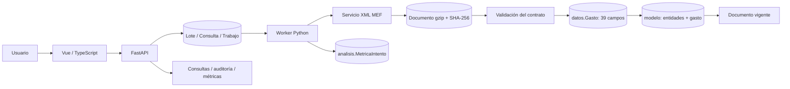

# Arquitectura y base de datos

ProInXML 1.0 utiliza Vue 3, Vue Router y Pinia; FastAPI; un worker Python con hilos; y SQL Server. La cola permanece en SQL para recuperar trabajos después de una interrupción.

## Procesamiento

1. La API valida host, ruta y parámetros de las URLs antes de registrar el lote. Repetidas dentro del lote se omiten; consultas publicadas generan trabajos `YaCargada`.
2. El worker toma trabajos mediante el procedimiento `integracion.TomarTrabajo`, con `UPDLOCK`, `READPAST`, token y lease. La concurrencia predeterminada es ocho.
3. La respuesta completa se guarda comprimida; SHA-256 se calcula sobre los bytes originales. El documento se identifica por consulta y huella.
4. El lector valida raíz, namespace, campos y tipos. La respuesta original permanece aunque el documento sea rechazado. El detalle se inserta por bloques de 500 dentro de una única transacción por documento.
5. Un bloqueo de aplicación coordina validación, inserción y normalización. Publicar el documento y completar el trabajo pertenecen a la misma transacción. Los XML truncados revierten su detalle.
6. Las métricas se confirman por separado para conservar el diagnóstico de errores. Los fallos de observabilidad se registran en logs sin volver fallida una carga correcta.

El normalizador deduplica las claves de `SecuenciaFuncional` y `Meta` antes de resolver sus relaciones. Las respuestas válidas sin Items salen antes de recorrer las entidades. No cambia las reglas de unicidad ni la reconstrucción de los campos XML.

## Tablas y vistas

Son **45 tablas**, todas con `CreadoUtc`. El [DBML](DIAGRAMA_BD.dbml.txt) contiene los 313 campos, 47 FK y 13 grupos funcionales. `dbo.sysdiagrams` pertenece a SSMS y queda fuera del modelo del proyecto.

| Esquema | Contenido |
| --- | --- |
| `integracion` | Servicio, Lote, Consulta, Trabajo, Intento, Documento, ObservacionDato |
| `datos` | Gasto con los 39 campos, DocumentoId y Ordinal |
| `modelo` | 29 entidades y Gasto; el hecho utiliza la identidad del detalle |
| `catalogo` | TipoActProy: 2 Proyecto, 3 Actividad |
| `seguridad` | Rol, Usuario y EventoAcceso |
| `auditoria` | Cambio y CargaDocumento |
| `analisis` | MetricaIntento, con duraciones, HTTP, filas y concurrencia |

`Consulta` es única por servicio, año, nivel de gobierno y ejecutora. Su FK compuesta al documento vigente garantiza que publica una versión de esa misma consulta. El detalle es único por documento y ordinal. `Meta` incluye secuencia funcional, código, finalidad y unidad opcional en su clave.

| Vista | Propósito |
| --- | --- |
| `datos.GastoActual` | Detalle de documentos vigentes |
| `datos.vw_GastoXML` | Exactamente los 39 campos XML, en orden y sin DISTINCT |
| `modelo.GastoActual` | Hechos de documentos vigentes |
| `modelo.GastoReconstruido` | Reconstrucción de los 39 campos a partir del modelo |
| `reportes.EjecucionServicio` | HTTP, estados, tiempos y conteos por intento |

## Organización SQL

| Script | Responsabilidad |
| --- | --- |
| `001_base.sql` | Esquemas, 14 tablas base, FK, índices, rol SQL y catálogos iniciales |
| `002_modelo.sql` | 29 entidades y tabla de hechos, con sus claves |
| `003_normalizacion.sql` | Procedimiento de normalización y reconstrucción |
| `004_operacion.sql` | Cola, vistas, triggers de auditoría y permisos |
| `005_metricas.sql` | Tabla de mediciones e índices de análisis |

La instalación crea directamente el esquema final, sin pasar por tablas o estados del prototipo. Los scripts pueden reaplicarse sobre el esquema actual. `scripts/desarrollo/build_model_sql.py` genera 002 y 003 desde `app/model_schema.py`; no se ejecuta durante el arranque.

## Seguridad y auditoría

La API comprueba sesión, cuenta activa y rol en cada petición. Las contraseñas usan Argon2; las cookies son HttpOnly/SameSite Strict y las modificaciones desde navegador requieren CSRF. Se admite Bearer para API. Las sesiones viven en memoria y se utiliza una instancia de proceso API.

El contexto SQL identifica usuario, actor, rol y correlación. `auditoria.Cambio` registra cambios de configuración, usuarios y cola, excluyendo hashes de contraseñas. El volumen XML se resume en `CargaDocumento`; no se genera una fila de auditoría por Item. Los triggers y permisos protegen la inmutabilidad de las bitácoras.

Mantenimiento toma un bloqueo exclusivo y exige que no existan trabajos en curso. La limpieza de cargas preserva cuentas, configuración, auditoría y métricas. Las referencias históricas de auditoría y análisis no tienen FK a documentos/lotes eliminables; no se reinician identidades.

## Ejecución local

`iniciar.cmd` administra API, worker y Vite como procesos separados. El navegador usa el proxy de Vite y conserva el mismo origen para cookies/CSRF; no necesita configurar CORS. `--compilado` sirve Vue desde FastAPI sin Node activo. Ctrl+C detiene los procesos del lanzador y una salida inesperada de un hijo cierra el conjunto.

El seguimiento consulta cada tres segundos, evita solicitudes superpuestas, descarta respuestas obsoletas y pausa al ocultar la pestaña. La navegación se agrupa en procesamiento, consultas y administración; la API vuelve a comprobar los permisos independientemente del menú.
