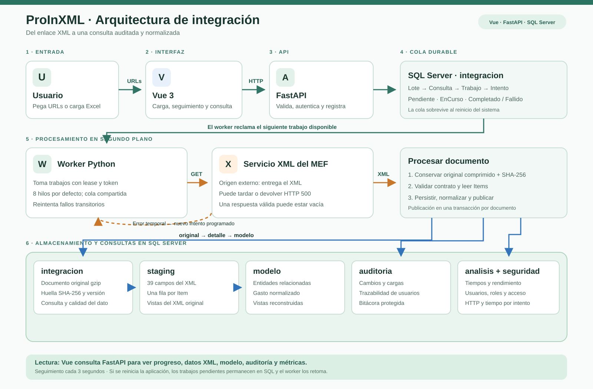

# Diagrama de arquitectura de ProInXML

[Abrir o descargar el SVG](DIAGRAMA_ARQUITECTURA.svg). El archivo es vectorial y puede insertarse en PowerPoint o exportarse a PNG desde un navegador.

## Guion breve para explicarlo

1. El usuario pega URLs o importa un Excel en **Vue**. **FastAPI** valida la entrada, autentica al usuario y registra un lote de trabajos en **SQL Server**.
2. El **worker Python** toma trabajos de una cola compartida y persistente. Por defecto hay ocho hilos. Cada hilo descarga un XML del servicio del MEF. Ante fallos transitorios se programa otro intento; el usuario no tiene que volver a cargar la URL.
3. Una respuesta completa se conserva comprimida junto con su huella SHA-256. Luego se valida el XML y cada Item se guarda en **`staging.Gasto`**, con los 39 campos originales.
4. Un procedimiento SQL construye las entidades y el gasto de **`modelo`**. El detalle, la normalización y la publicación del documento válido se confirman en una transacción. Un XML válido sin Items queda como **CompletadoSinDatos**.
5. **Auditoría** conserva los cambios y resultados de carga; **análisis** mide tiempos; **seguridad** gestiona usuarios y roles. Vue consulta la API cada tres segundos para actualizar seguimiento y métricas.

La cola está en SQL Server: después de un corte de energía, los trabajos pendientes siguen allí. Al volver a iniciar el worker, recupera los trabajos cuyo tiempo de reserva expiró y continúa procesando. Las descargas pueden hacerse en paralelo; la persistencia y normalización de cada documento usa bloqueos para mantener consistencia.

Para el detalle técnico y los límites actuales, consultar [Arquitectura](ARQUITECTURA.md) y [Flujos del sistema](FLUJOS_SISTEMA.md).
