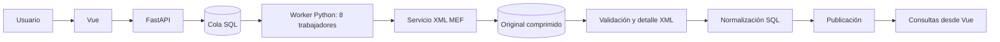
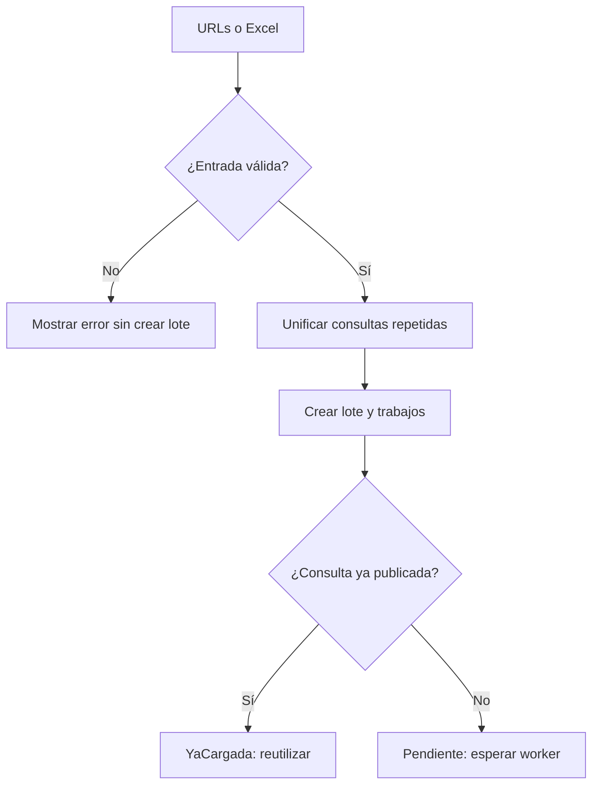
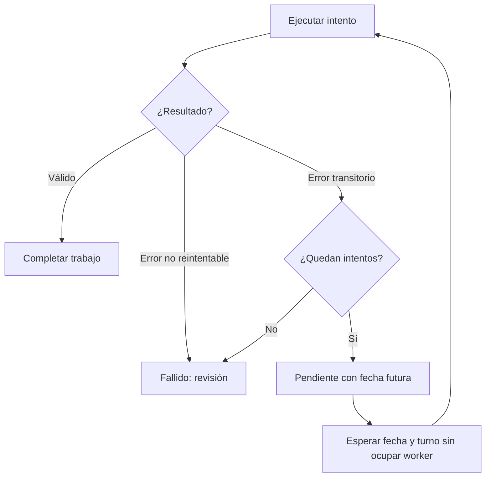

# ProInXML 1.0: flujos y comportamiento del sistema

Guía para explicar y demostrar el sistema. Revisada contra el código de la versión actual el **29 de octubre de 2026**. Los límites indicados son los valores predeterminados; `.env` puede cambiar la concurrencia y algunos tiempos.

La [presentación PowerPoint](presentacion/ProInXML_flujos_1.0.pptx) resume esta guía en 22 diapositivas editables con diagramas, ejemplos y notas para el expositor. También está disponible una [copia en PDF](presentacion/ProInXML_flujos_1.0.pdf) para revisión. Se puede presentar en unos 15–20 minutos o utilizar cada bloque por separado.

## 1. Qué problema resuelve

El usuario entrega URLs del servicio XML del MEF. ProInXML registra el trabajo, descarga las respuestas, conserva evidencia del origen, valida sus datos y publica una representación consultable y otra organizada en entidades relacionadas. Una caída temporal del origen puede generar reintentos sin obligar al usuario a volver a pegar los enlaces.

**Recorrido principal:** entregar URLs → registrar lote → tomar trabajo → descargar → guardar original → validar y guardar detalle → normalizar → publicar → consultar.

Registrar un lote confirma que quedó en la cola. **Completado** confirma que el documento válido quedó procesado y publicado. Un HTTP 200, por sí solo, no confirma que el contenido sea un XML válido ni que se haya publicado.

## 2. Las piezas y sus responsabilidades

| Pieza | Responsabilidad |
| --- | --- |
| Vue 3 | Entrada de enlaces, seguimiento, consultas, observaciones y administración. |
| FastAPI | Comprueba sesiones y permisos, valida solicitudes y ofrece las operaciones de la interfaz. |
| Worker Python | Toma trabajos de la cola y ejecuta descarga y procesamiento. Usa ocho trabajadores por defecto. |
| SQL Server | Conserva la cola, originales, detalle XML, modelo relacional, auditoría y métricas. Ejecuta la normalización. |
| Servicio MEF | Origen externo: puede responder, tardar, devolver un error o entregar contenido inválido. |

Los ocho trabajadores consumen **una misma cola persistente**, no ocho colas independientes. Cada trabajador ocupa un lugar durante todo el procesamiento de su documento, incluidas las esperas SQL. La descarga puede avanzar en paralelo; un bloqueo global serializa la escritura del detalle y la normalización.

## 3. Vocabulario: qué representa cada registro

| Concepto | Significado | Ejemplo ilustrativo |
| --- | --- | --- |
| Lote | Conjunto de consultas entregadas en una operación de carga. | «Prueba de 1.000 URLs». |
| Consulta | Identidad de una solicitud al servicio: servicio, año, nivel de gobierno y ejecutora. | Año 2021, nivel E, ejecutora 3. |
| Trabajo | Encargo de procesar una consulta dentro de un lote; tiene estado y presupuesto de intentos. | Pendiente, EnCurso o Completado. |
| Intento | Una ejecución concreta del trabajo, con HTTP, fechas, errores y conteos. | Primer intento HTTP 500; segundo HTTP 200. |
| Documento | Respuesta completa conservada, identificada por consulta y huella SHA-256. | El cuerpo XML, o una respuesta HTTP de error recibida completa. |
| Registro XML | Un Item del documento con sus 39 campos y su ordinal. | Una fila de `staging.Gasto`. |
| Documento vigente | Versión válida publicada para una consulta. | La apuntada por `Consulta.DocumentoActualId`. |

Una consulta puede tener varias versiones de documento y varios intentos. Un intento con error no significa necesariamente que el trabajo termine fallido.

## 4. Acceso, sesiones y usuarios

1. El usuario inicia sesión con su cuenta y contraseña. Se comprueba que esté activa y se verifica la contraseña con Argon2.
2. Se registra el evento de acceso, exitoso o fallido. Existe limitación de intentos de acceso por IP y nombre de usuario.
3. La API entrega una sesión; desde el navegador se utiliza una cookie HttpOnly y protección CSRF para las modificaciones.
4. Cada petición protegida vuelve a comprobar identidad y rol. Ocultar una opción del menú no sustituye esta comprobación.
5. Cerrar sesión invalida la sesión y devuelve a la pantalla de acceso. La sesión predeterminada dura una hora y la interfaz muestra el tiempo restante; reiniciar la API requiere ingresar de nuevo porque las sesiones están en memoria.

| Acción | Consulta | Operador | Administrador |
| --- | :---: | :---: | :---: |
| Consultar datos, seguimiento, ejecución, observaciones y métricas | Sí | Sí | Sí |
| Crear cargas y reintentar trabajos fallidos | No | Sí | Sí |
| Forzar revisión de una carga completada | No | No | Sí |
| Ver auditoría, gestionar usuarios y limpiar cargas | No | No | Sí |

En **Usuarios**, el administrador crea o edita cuentas, asigna rol, cambia contraseña o desactiva la cuenta. Los cambios en una cuenta existente invalidan sus sesiones. El sistema impide dejar la instalación sin un administrador activo. La identidad `sistema` está reservada al worker y no puede iniciar sesión.

## 5. Entregar URLs y registrar el lote

### Entrada manual

Se aceptan de **1 a 1.000 URLs** por solicitud, una por línea en la interfaz. Primero se validan todas. Si hay enlaces inválidos, se devuelve el error antes de crear el lote; no se importa silenciosamente una parte de la lista.

### Entrada por Excel

Se lee la primera columna de un XLSX, preferentemente de la hoja `XML`, o de la hoja activa si aquella no existe. El encabezado es opcional y las celdas vacías se omiten. Admite hasta **50.000 filas de datos**, archivo de **10 MiB** y contenido descomprimido de hasta **100 MiB**. Es un límite de importación, no una garantía de rendimiento para ese volumen.

### Comprobaciones comunes

- Se admite el host `s3.mef.gob.pe` y el endpoint MEF implementado; el sistema actual no es un importador de cualquier XML de Internet.
- Se validan esquema HTTP/HTTPS, ruta y los parámetros `anoEje`, `nivelGobierno` y `sec_ejec`; se rechazan parámetros ausentes, repetidos o desconocidos.
- El año debe estar entre 1900 y 2100; el nivel es E, M o R; la ejecutora es un entero positivo dentro del rango admitido.
- Las consultas repetidas dentro de la entrada se unifican por año, nivel y ejecutora, aunque sus URLs tengan un orden distinto de parámetros.
- Si la consulta ya tiene un documento válido publicado, el trabajo queda `YaCargada`; no se descarga de nuevo.
- Las demás quedan `Pendiente`, vinculadas al lote y a su usuario creador.

## 6. Tomar un trabajo y descargar

Un trabajador libre solicita un trabajo a `integracion.TomarTrabajo`. SQL Server selecciona un pendiente cuya fecha `ProximoIntentoUTC` ya llegó y que todavía tenga intentos disponibles. El orden es **próxima fecha de intento y después Id**. El worker habitual consume la cola global, sin limitarse a un lote.

La toma es atómica: marca `EnCurso`, aumenta el contador, crea un token de pertenencia y reserva el trabajo por diez minutos (lease). También crea el registro del intento con su hora inicial. El token evita que un trabajador antiguo confirme un trabajo que ya fue recuperado por otro.

Durante la descarga:

| Control | Valor actual |
| --- | --- |
| Espera de conexión | 10 segundos. |
| Espera de lectura | 45 segundos por operación de lectura; no equivale a 45 segundos para todo el documento. |
| Presupuesto de descarga | 180 segundos, comprobado entre bloques recibidos; no es un corte exacto por temporizador. |
| Tamaño máximo | 32 MiB por respuesta, no para toda la aplicación. |
| Redirecciones | No se siguen automáticamente. |

Si se recibe la respuesta completa, se calcula SHA-256 sobre sus bytes y se guarda con gzip. Esto se confirma en una transacción independiente, antes de validar el XML. Una respuesta HTTP 500 completa también puede conservarse como evidencia. Un fallo de conexión o una descarga interrumpida no garantiza disponer de un cuerpo original completo.

## 7. Validar, guardar detalle y normalizar

1. Se adquieren los bloqueos de persistencia. Los demás documentos pueden seguir descargándose, pero esperan para entrar a esta sección.
2. Si ese documento ya era válido, se reutiliza su detalle confirmado.
3. Si es nuevo o todavía no es válido, se comprueban raíz `DataGasto`, namespace del MEF, estructura de Items, campos, tipos y correspondencia con la consulta de origen. Se rechazan DTD y entidades externas.
4. Los Items se leen y se insertan por bloques de hasta **500 filas** en `staging.Gasto`. Esos bloques pertenecen a **una misma transacción por documento**; no se confirman individualmente.
5. Se registran observaciones de calidad. Si no hay errores de calidad, `modelo.NormalizarDocumento` crea las entidades que falten y resuelve sus relaciones antes de insertar `modelo.Gasto`.
6. Se marca el documento válido y vigente, se completa trabajo e intento y se confirma la transacción. Si el XML válido contiene cero Items, queda `CompletadoSinDatos`.

La transacción de publicación incluye detalle, modelo y estado final. Un XML que falla al final de la lectura no queda publicado con solo sus primeras filas. El original previamente confirmado permanece disponible.

### Tres resultados diferentes de validación

| Situación | Original | Detalle | Modelo y publicación |
| --- | --- | --- | --- |
| XML válido, con o sin advertencias | Se conserva. | Se confirma. | Se normaliza y publica. |
| `TipoActProy` entero diferente de los ejemplos conocidos | Se conserva. | No se interpreta ni genera error por el código. | Se normaliza y publica si los demás campos son válidos. |
| XML truncado, contrato distinto, campo obligatorio vacío o tipo inválido | Se conserva si se recibió completo. | Se revierte la transacción de detalle de ese procesamiento. | No se publica. |

`Unidad_Medida` vacía, ausente o con `nil` es una **advertencia**: se almacena NULL y permite completar. No se inventa una unidad para llenar el campo. Se preservan `AnoEje`, códigos con ceros iniciales, `MesEje=0` e importes `DECIMAL(19,4)`.

## 8. Reintentos automáticos y orden de la cola

Son reintentables los errores de red/timeout y HTTP **408, 429 o 5xx**. Los errores de persistencia SQL también se tratan como reintentables cuando es posible registrar el fallo. Los restantes HTTP distintos de 200, los errores de XML, calidad y límites de tamaño requieren revisión y no se reintentan automáticamente.

Al fallar un intento reintentable:

1. Se cierra ese intento como `Error`, con su etapa, HTTP si existe, hora final y mensaje.
2. Si quedan oportunidades, el trabajo vuelve a `Pendiente` y se programa su próxima fecha.
3. El trabajador se libera para tomar otra URL. No duerme ocupando ese lugar durante el tiempo programado.
4. Cuando la fecha llegó y el trabajo alcanza su turno, cualquier trabajador libre puede tomarlo.

El valor predeterminado es **cuatro intentos totales: uno inicial y hasta tres reintentos**, no cuatro reintentos adicionales.

| Fallo del intento | Espera mínima programada antes del siguiente intento |
| --- | --- |
| Primero | 15–25 segundos. |
| Segundo | 30–40 segundos. |
| Tercero | 60–70 segundos. |
| Cuarto | Trabajo `Fallido`; puede solicitarse un reintento manual. |

La variación aleatoria evita programar todas las recuperaciones al mismo instante. El tiempo real puede ser mayor por la cola, la disponibilidad de trabajadores o una pausa automática del servicio.

### Por qué parece una «segunda vuelta»

Las URLs nuevas del mismo lote suelen conservar una fecha pendiente anterior a la nueva fecha de sus reintentos. Por eso, normalmente se toman primero las URLs que aún no comenzaron y después las que fallaron. **No hay una barrera que espere a que termine todo el lote**: un reintento puede comenzar mientras otros documentos siguen en curso. Entre lotes, manda igualmente la fecha, no una ronda fija.

**Ejemplo ilustrativo, no medición:** de 1.000 trabajos, seis fallan una vez con HTTP 500 y luego tienen éxito. El resultado puede mostrar 1.000 trabajos completados y 1.006 intentos, de los cuales seis figuran con error. Las seis URLs recuperadas no son seis fallos definitivos.

## 9. Caída general del servicio e interrupciones

### Pausa automática por fallos del origen

Tras **cinco fallos transitorios consecutivos observados** se abre un circuito de protección y el proceso worker deja de tomar trabajos nuevos durante **30 segundos** por defecto. Las operaciones ya en curso pueden terminar. La cuenta se comparte entre los hilos de ese proceso; una respuesta HTTP 200 reinicia la secuencia de fallos. Esta pausa puede coexistir con las fechas de reintento y no es una pausa manual del lote.

### Cierre de la aplicación o caída del worker

La cola permanece en SQL Server. Los trabajos pendientes no se pierden. Los trabajos `EnCurso` quedan reservados hasta que venza su lease de diez minutos. Con el worker en ejecución, una toma posterior recupera los vencidos, marca el intento anterior `Interrumpido` y vuelve a poner el trabajo pendiente.

Esta recuperación no consume una oportunidad adicional del presupuesto de errores: se compensa el contador del intento interrumpido, pero su historial se conserva. Si SQL está caído, la recuperación necesita que la base vuelva a estar disponible. No se promete conservar métricas que nunca llegaron a confirmarse.

## 10. Reintentar manualmente y forzar revisión

| Acción | Quién | Cuándo | Efecto |
| --- | --- | --- | --- |
| Reintentar | Operador o Administrador | Trabajo `Fallido`. | Reinicia el contador operativo de intentos y lo pone pendiente inmediatamente; conserva el historial anterior. |
| Forzar revisión | Administrador | En la interfaz, trabajos completados, sin datos o ya cargados. | Encola otra descarga aunque exista publicación. El endpoint también admite un trabajo fallido. |

«Inmediatamente» significa que queda elegible; sigue esperando su turno. No inicia una descarga dentro de la petición del botón.

En una revisión forzada, **misma consulta y misma huella válida** reutilizan el documento y los datos, sin insertar otra copia del contenido. Si el contenido cambia y resulta válido, se conserva una versión nueva y se actualiza el documento vigente. Si la nueva descarga o validación falla, la publicación válida anterior permanece. La numeración histórica de intentos continúa aunque el contador operativo se reinicie.

## 11. Estados: trabajo e intento son cosas distintas

| Estado del trabajo | Qué significa |
| --- | --- |
| `Pendiente` | Espera primer intento, fecha de reintento o recuperación. |
| `EnCurso` | Un trabajador tiene su token y lo está procesando. |
| `Completado` | Documento válido con registros procesados y publicado. |
| `CompletadoSinDatos` | Documento válido publicado con cero Items. |
| `YaCargada` | La consulta tenía una publicación válida y se reutilizó sin descargar. |
| `Fallido` | Error no reintentable o presupuesto de intentos agotado. |
| `Cancelado` | Mantenimiento eliminó el documento asociado al trabajo. |

Los intentos utilizan `EnCurso`, `Completado`, `Error` o `Interrumpido`. No se borra un intento con error cuando otro posterior tiene éxito. HTTP NULL significa que no se registró un código de respuesta; no debe interpretarse como HTTP 500.

## 12. Qué muestra cada pantalla

| Grupo y pantalla | Pregunta que responde | Acciones principales |
| --- | --- | --- |
| Procesamiento · Carga de datos | ¿Qué URLs quiero ingresar? | Pegar enlaces, importar Excel y registrar lote. |
| Procesamiento · Seguimiento | ¿Cómo va cada trabajo de la carga? | Seleccionar lote, filtrar estado, consultar registros e intentos, inspeccionar respuesta, reintentar o forzar según permisos. |
| Procesamiento · Ejecución del servicio | ¿Qué pasó en cada intento? | Filtrar lote, trabajo, HTTP, resultado o solo fallos; revisar fechas, errores y conteos. |
| Procesamiento · Métricas de carga | ¿Dónde se consume el tiempo? | Filtrar muestras y revisar fases, promedio, P95, XML/min y filas/s. |
| Consultas · Registros XML | ¿Qué valores llegaron? | Consultar los 39 campos, filtrar año/ejecutora/proyecto/documento y revisar trazabilidad. Por defecto muestra documentos vigentes. |
| Consultas · Modelo 3FN | ¿Cómo quedaron relacionados? | Explorar entidades, buscar registros y seguir claves foráneas. Es de solo lectura y puede incluir datos históricos. |
| Consultas · Observaciones | ¿Qué está incompleto o fue rechazado? | Filtrar advertencias/errores, revisar campo y valor observado, documento y muestra del original. |
| Administración · Auditoría | ¿Quién cambió qué y qué respuesta se cargó? | Consultar cambios, cargas y eventos de acceso; filtrar cargas sin datos, inspeccionar la respuesta guardada y abrir el XML de origen. |
| Administración · Usuarios | ¿Quién puede usar el sistema? | Crear y editar cuentas, roles, contraseñas y estado activo. |
| Administración · Mantenimiento | ¿Qué datos del laboratorio quiero retirar? | Vista previa y eliminación por documento o de todas las cargas. |

### Actualización de las pantallas

Seguimiento y métricas usan peticiones periódicas, con intervalo de tres segundos después de terminar la petición anterior. No son WebSockets ni actualizaciones por cada fila insertada. Se evita superponer peticiones, se descartan respuestas obsoletas, se cancela al salir y se suspende la consulta mientras la pestaña está oculta. Al volver a mostrarla se solicita una actualización.

La hora de actualización indica la última consulta exitosa de esa pantalla. El indicador de conexión comprueba la salud SQL periódicamente; no demuestra por sí solo que el origen MEF esté disponible ni que el proceso worker esté activo.

## 13. Auditoría, ejecución y métricas

Estas evidencias se complementan; no representan la misma cosa:

| Evidencia | Qué conserva |
| --- | --- |
| `integracion.Intento` / `reportes.EjecucionServicio` | Cada ejecución: inicio/fin, HTTP, etapa, error y registros. |
| `auditoria.Cambio` | Cambios en configuración, cuentas y operación; actor, contexto y correlación. |
| `auditoria.CargaDocumento` | Resumen de filas nuevas o reutilizadas por documento, sin crear un evento por cada Item. |
| `seguridad.EventoAcceso` | Eventos de autenticación y de gestión de usuarios. |
| `analisis.MetricaIntento` | Duración por fase, resultado, bytes, filas y concurrencia configurada. |

Las fases son descarga, guardar original, espera de bloqueos SQL, lectura/validación, inserción, normalización y confirmación. **P95** es el tiempo dentro del cual terminó aproximadamente el 95 % de las muestras de la fase. Los tiempos se registran por intento; una URL reintentada puede producir varias mediciones.

La espera SQL mide adquisición de bloqueos de la aplicación; no es un diagnóstico completo de todas las esperas internas de SQL Server. La concurrencia registrada es la configurada, no el número de descargas activas en cada instante. Filas/s mide filas nuevas confirmadas, que pueden incluir detalle rechazado por calidad; no equivale a filas publicadas. Las métricas tienen transacción independiente para conservar evidencia de fallos cuando la base lo permite.

## 14. Mantenimiento: eliminar un documento o vaciar cargas

Solo el administrador puede hacerlo:

1. Elegir un documento o todas las cargas.
2. Obtener una vista previa con conteos y una revisión del estado de los staging.
3. Escribir el motivo y la confirmación exacta: `ELIMINAR DOCUMENTO <id>` o `VACIAR CARGAS`.
4. El sistema vuelve a comprobar permisos, revisión y ausencia de trabajos en curso, con bloqueos que coordinan la operación.
5. Ejecutar eliminación y registrar su auditoría dentro de la misma transacción.

| Alcance | Se elimina o modifica | Se conserva |
| --- | --- | --- |
| Un documento | Original, detalle, observaciones y gasto normalizado del documento; se podan entidades sin referencias. Los trabajos vinculados pasan a Cancelado y se retiran los enlaces al documento. | Lotes, consultas, intentos históricos, cuentas, configuración, auditoría y métricas. Si era vigente, la consulta queda sin publicación; no se activa automáticamente una versión anterior. |
| Todas las cargas | Documentos, detalle, hechos, observaciones, intentos, trabajos, consultas y lotes; se vacían las entidades del modelo. | Usuarios, roles, servicio, auditoría y métricas. Los IDs no se reinician. |

Si hay un trabajo `EnCurso` o cambió la revisión desde la vista previa, la operación se rechaza y se debe revisar nuevamente. La limpieza no significa eliminar todas las tablas ni toda la evidencia histórica de la base.

## 15. Guion sencillo para una demostración

1. Iniciar sesión como Operador o Administrador y señalar los tres grupos del menú.
2. Registrar una URL conocida. Abrir Seguimiento y explicar Pendiente → EnCurso → Completado, sin prometer capturar visualmente cada transición.
3. Mostrar Ejecución del servicio: HTTP, inicio/fin y número de registros. Mostrar las fases en Métricas.
4. Abrir Registros XML y el Modelo 3FN: dos representaciones del mismo documento.
5. Volver a entregar la misma consulta publicada: explicar `YaCargada` y ausencia de una nueva descarga.
6. Mostrar un historial existente de HTTP 500 seguido de éxito. No es necesario provocar una caída del servicio real.
7. Mostrar una observación por unidad vacía y explicar por qué permite publicar. Si existe un documento rechazado, compararlo con la advertencia.
8. Con Administrador, mostrar Usuarios, Auditoría y la **vista previa** de Mantenimiento. La eliminación es opcional y solo se demuestra con datos prescindibles.

## 16. Alcance actual y límites que conviene mencionar

- Implementado para el endpoint y contrato MEF definidos; otro servicio requiere adaptar el lector y el modelo.
- Cola durable en SQL, reintentos finitos y recuperación por lease; no hay un calendario de rondas ni garantía de entrega exactamente una vez. Las claves, huellas y transacciones evitan duplicaciones en los casos previstos.
- No hay controles manuales para pausar y reanudar lotes. Sí existe la pausa automática ante fallos transitorios del origen.
- Las consultas ya publicadas no se revisan periódicamente por sí solas; el Administrador puede forzar revisión.
- La API mantiene sesiones en memoria de una instancia. Cerrar el navegador no detiene el worker; cerrar el lanzador sí detiene sus procesos.
- El tamaño por respuesta, los trabajadores, la memoria, el disco y la capacidad SQL condicionan el volumen. Más trabajadores no implican más normalizaciones simultáneas.
- El modelo relacional usa claves de contexto propuestas a partir del XML; los nombres y dependencias de maestros oficiales requieren validación adicional.

## 17. Correspondencia con el código

| Flujo | Implementación principal |
| --- | --- |
| Entrada y validación de solicitudes | [`app/api/main.py`](../app/api/main.py), [`app/domain/xml_reader.py`](../app/domain/xml_reader.py). |
| Creación de lote, evidencia, publicación y reprogramación | [`app/integration/service.py`](../app/integration/service.py). |
| Descarga, clasificación de fallos y circuito | [`app/integration/worker.py`](../app/integration/worker.py). |
| Toma de trabajos y recuperación por lease | [`sql/004_operacion.sql`](../sql/004_operacion.sql). |
| Modelo y normalización | [`app/domain/model_schema.py`](../app/domain/model_schema.py), [`sql/003_normalizacion.sql`](../sql/003_normalizacion.sql). |
| Consultas, calidad y documentos | [`app/api/explorer.py`](../app/api/explorer.py). |
| Seguridad, sesiones y cuentas | [`app/api/security.py`](../app/api/security.py). |
| Eliminación y conservación de evidencia | [`app/api/maintenance.py`](../app/api/maintenance.py). |
| Medición y reportes de rendimiento | [`app/integration/metrics.py`](../app/integration/metrics.py), [`app/api/analysis.py`](../app/api/analysis.py). |
| Actualización periódica de la interfaz | [`usePolling.ts`](../frontend/src/composables/usePolling.ts). |

Documentación complementaria: [arquitectura](ARQUITECTURA.md), [operación](OPERACION.md), [contrato XML](CONTRATO_XML.md), [modelo](MODELO_3FN.md) y [métricas](METRICAS.md).
