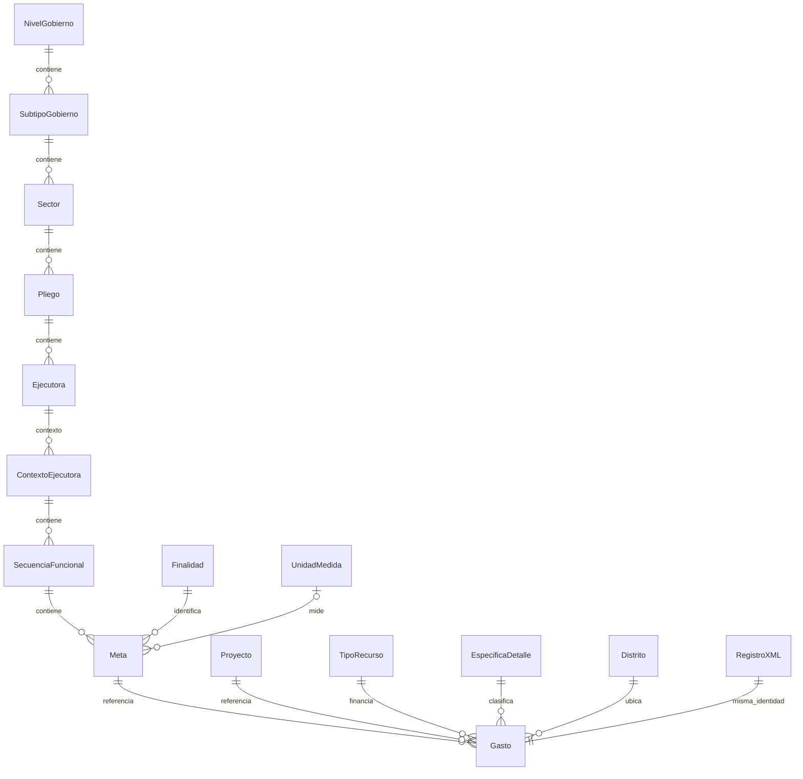

# Modelo relacional propuesto y datos de origen

El proyecto conserva dos representaciones. `datos.Gasto` registra los 39 campos
de cada Item, su documento y su ordinal. El esquema `modelo` organiza esos valores
en 29 entidades y una tabla de gasto con claves foraneas. No se elimina ni se
sustituye el registro de origen. `modelo.Gasto.Id` comparte la clave primaria de
`datos.Gasto`: cada ocurrencia y cada version mantiene su identidad.

La pantalla Modelo 3FN es el explorador de esta propuesta. La normalizacion se
basa en las dependencias y claves declaradas aqui; no equivale a disponer de un
modelo oficial completo del MEF. Las dependencias adicionales, nombres y vigencias
deben contrastarse con los maestros y el contrato completo del servicio antes de
cerrar un diseno definitivo de 3FN. Dividir una tabla en muchas no demuestra, por
si solo, la tercera forma normal.

## Entidades y claves

Todas las entidades tienen `Id` como PK. Sus combinaciones de codigo/contexto
tienen restricciones UNIQUE. Los campos que representan un padre tienen FK.

| Grupo | Tablas | Contexto de la clave |
|---|---|---|
| Instituciones | NivelGobierno, SubtipoGobierno, Sector, Pliego, Ejecutora | Codigo del nivel; codigo mas padre para cada hijo |
| Ejercicio institucional | ContextoEjecutora | EjecutoraId + AnoEje + SecEjec |
| Presupuesto | Funcion, ProgramaFuncional, ProgramaPresupuestal, CategoriaGasto | Codigo; el programa funcional se identifica dentro de Funcion |
| Clasificadores | TipoTransaccion, Generica, Subgenerica, SubgenericaDetalle, Especifica, EspecificaDetalle | Codigo mas el clasificador padre |
| Financiamiento | FuenteFinanciamiento, Rubro, TipoRecurso | Codigo; rubro dentro de fuente y recurso dentro de rubro |
| Proyectos | Proyecto, ProyectoSNIP, Componente | Cada codigo recibido, incluidos codigos genericos y cero |
| Metas | Finalidad, UnidadMedida, SecuenciaFuncional, Meta | Secuencia dentro de ContextoEjecutora; meta dentro de secuencia, finalidad y unidad |
| Ubicaciones | Departamento, Provincia, Distrito | Codigo departamental; provincia dentro de departamento; distrito dentro de provincia |
| Gasto | Gasto | Id compartido con el registro XML, FK a las entidades, mes y siete importes |

`catalogo.TipoActProy` conserva la regla del Excel (2 Proyecto, 3 Actividad) y se
consulta desde el explorador junto con las 30 tablas nuevas.

El gasto contiene referencias a Meta, ProgramaFuncional, ProgramaPresupuestal,
CategoriaGasto, EspecificaDetalle, TipoRecurso, Proyecto, ProyectoSNIP, Componente,
Distrito y TipoActProy. El anio, ejecutora y secuencia se recuperan recorriendo
Meta -> SecuenciaFuncional -> ContextoEjecutora -> Ejecutora. Los codigos de
clasificadores y de ubicacion se recuperan recorriendo sus padres. No se repiten
esos codigos ancestrales en el hecho normalizado.

## Claves conservadoras

- No se deduce que SecEjec tenga la misma adscripcion institucional en todos los
  ejercicios. ContextoEjecutora conserva la combinacion recibida.
- No se fuerza una relacion uno a uno entre IdProyecto e IdProyectoSNIP ni se
  asignan nombres a codigos genericos como 3999999 o 0. El gasto conserva ambas
  referencias para cada ocurrencia.
- No se fuerza que una pareja SecFunc/IdMeta determine siempre la misma finalidad
  y unidad de medida. Esos valores forman parte de la clave de contexto de Meta,
  para conservar las variantes sin sobrescribirlas. Si el maestro confirma una
  dependencia mas estricta, se podra ajustar la restriccion natural y validar sus
  conflictos como una regla de negocio adicional.
- Los codigos de provincia y distrito se identifican con sus padres; un distrito
  `01` no se mezcla con el `01` de otra provincia. Los codigos especiales recibidos
  se conservan, sin atribuirles nombres o equivalencias no presentes en la fuente.
- El modelo conserva MesEje=0, ceros iniciales y DECIMAL(19,4).

## Sincronizacion, auditoria y comprobacion

`modelo.NormalizarDocumento` carga las entidades en orden de dependencias y luego
el gasto. Se ejecuta en la misma transaccion que confirma los registros extraidos.
El bloqueo de aplicacion serializa la actualizacion del modelo y evita carreras
en las claves naturales. Una segunda ejecucion con el mismo contenido no agrega
entidades ni gastos, ni genera eventos por modificaciones inexistentes.

Las 30 tablas del modelo se auditan por documento mediante
`auditoria.CargaDocumento`, junto con el detalle. No tienen triggers por fila.
Los cambios operativos y de usuarios permanecen en `auditoria.Cambio`.
Las pantallas de exploración son de solo lectura; el modelo no sincroniza
ediciones SQL directas del detalle automáticamente.

`modelo.GastoReconstruido` obtiene los 39 campos desde las entidades y las FK,
sin tomarlos de las columnas del registro original. Se compararon los 23.091
registros existentes, incluida su identidad: cero diferencias. La prueba de
integracion tambien verifica reconstruccion e idempotencia con la fixture.

`sql/002_modelo.sql` crea las entidades y restricciones; `sql/003_normalizacion.sql` instala el normalizador y la vista de reconstrucción. Ambos se generan desde el contrato Python.

`Unidad_Medida` es opcional: `Meta.UnidadMedidaId` acepta NULL, su clave natural
incluye ese valor y la comparación tolera nulos. Se usa LEFT JOIN al reconstruir;
no se crea una unidad ficticia. Todas las entidades y el hecho tienen CreadoUtc.
`modelo.GastoActual` limita el hecho a documentos vigentes. El bloqueo de
normalización se toma antes de insertar el detalle para evitar conflictos entre
documentos procesados en paralelo.

Referencias para revisar el diseno:
- [Principios de diseno y tercera forma normal, Microsoft](https://support.microsoft.com/en-us/access/database-design-basics).
- [Diccionario presupuestario, portal de datos del MEF](https://datosabiertos.mef.gob.pe/dataset/presupuesto-y-ejecucion-de-gasto-devengado-sectores/resource/cbb9626c-7fba-407e-95a0-60015c27b9fc).
- [Clasificadores presupuestarios del MEF](https://mef.gob.pe/index.php?Itemid=100290&id=356&lang=es&option=com_content&view=article).
